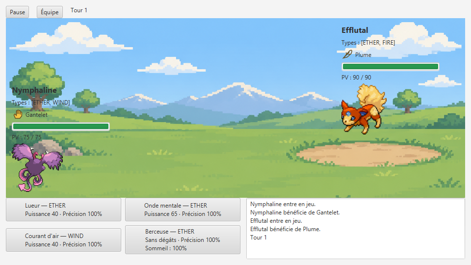
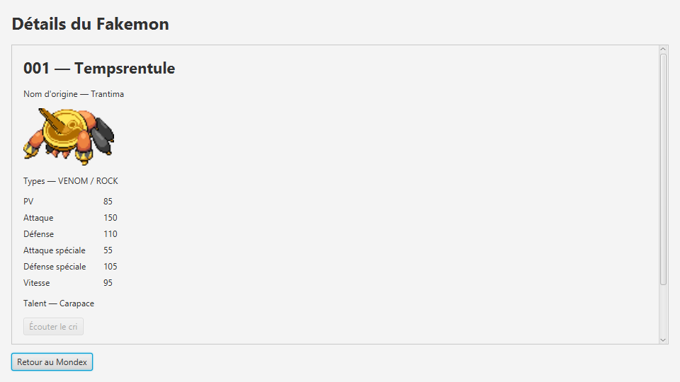

# Fakemon Arena

[](https://github.com/OnerAliCan/fakemon-arena/actions/workflows/ci.yml)

Jeu de combat au tour par tour en **Java 21 et JavaFX** : deux équipes de six Fakemon
s'affrontent contre l'ordinateur ou entre deux joueurs sur le réseau local.

Le catalogue comprend **30 espèces**, **38 attaques**, **4 talents**, **3 objets tenus**
et **5 statuts**. Chaque Fakemon reçoit quatre attaques. Une équipe perd lorsque tous
ses membres sont K.O. ou que son joueur abandonne. Il n'y a ni niveau ni PP à gérer.

## Installation

Prérequis : **JDK 21**, Git, un environnement graphique Windows ou macOS et une connexion
Internet pour télécharger les dépendances au premier lancement. `java -version` et
`javac -version` doivent indiquer Java 21. Maven et JavaFX sont téléchargés par le wrapper.

```sh
git clone https://github.com/OnerAliCan/fakemon-arena.git
cd fakemon-arena
```

Les scripts de configuration du poste installent les outils manquants et vérifient le projet :

- Windows : double-clic sur `setup-windows.bat`
- macOS : `bash setup-mac.command` dans le Terminal

Ces scripts utilisent Python 3 et GitHub CLI. Ils guident aussi l'installation de ces
outils lorsqu'ils manquent ; sur macOS, Homebrew est nécessaire pour installer les outils.

## Compiler, lancer et vérifier

Depuis le dossier du projet :

| | Windows | macOS |
|---|---|---|
| Compiler, tester et produire le JAR | `.\mvnw.cmd clean verify` | `./mvnw clean verify` |
| Jouer | `.\mvnw.cmd javafx:run` | `./mvnw javafx:run` |
| Tests et couverture | `.\mvnw.cmd verify` | `./mvnw verify` |
| Inclure les tests graphiques | `.\mvnw.cmd "-Dfakemon.ui.tests=true" test` | `./mvnw -Dfakemon.ui.tests=true test` |

Le lancement par Maven charge JavaFX et les dépendances du jeu. Dans VS Code,
la classe à lancer directement est `Launcher`.

`verify` produit le rapport JaCoCo dans `target/site/jacoco/index.html` et le JAR dans
`target/`. Les tests graphiques nécessitent un affichage et sont ignorés par défaut,
notamment dans la CI. Les tests réseau automatisés utilisent des connexions locales.

### Javadoc des écrans

Sous Windows, cette commande génère l'API publique du paquet `ui` et échoue si Javadoc
signale un avertissement :

```powershell
.\mvnw.cmd "-Dsubpackages=fr.epitech.fakemon.ui" "-Dmaven.javadoc.failOnWarnings=true" org.apache.maven.plugins:maven-javadoc-plugin:3.12.0:javadoc
```

Sur macOS, remplacer `.\mvnw.cmd` par `./mvnw`. Ouvrir ensuite
`target/reports/apidocs/index.html`.

## Jouer contre l'ordinateur

1. Ouvrir **Combat contre l'IA**, puis choisir le mode.
2. **Combat aléatoire** affiche actuellement les deux équipes avant le bouton **Combattre**.
   La suppression de cet aperçu est suivie dans [#42](https://github.com/OnerAliCan/fakemon-arena/issues/42).
3. **Combat construit** permet de choisir six espèces différentes, puis son premier
   Fakemon. Les attaques et les objets sont tirés au hasard.
4. Choisir une attaque, ou utiliser **Équipe** pour changer de Fakemon. Un changement
   volontaire consomme le tour. Après un K.O., un remplacement est obligatoire.
5. **Pause** ou **Échap**, pendant le choix d'une action, donne accès à **Reprendre**,
   **Volume** et **Abandonner**. En fin de combat, choisir **Revanche** ou **Menu**.

Les règles détaillées des types, dégâts, talents, objets et statuts sont dans
[le game design des règles](docs/gdd-regles.md).



## Jouer à deux en LAN

Les deux PC doivent lancer la même version du jeu et être connectés au même réseau
local. L'hôte doit connaître les espèces choisies par les deux joueurs. La connexion
utilise le **port TCP 5000** ; autoriser Java sur le réseau privé dans le pare-feu si nécessaire.

1. Sur le premier PC : **Combat en ligne → Héberger**, puis communiquer l'adresse IPv4 affichée.
2. Sur le second : saisir cette adresse dans **Combat en ligne**, puis cliquer sur **Rejoindre**.
3. L'invité clique sur **Prêt**. L'hôte choisit **Combat aléatoire** ou **Combat construit**,
   puis clique sur **Lancer**.
4. En mode construit, chacun choisit six espèces différentes et son premier combattant.
   Le combat démarre après validation des deux équipes par l'hôte.
5. Chaque joueur choisit son action en parallèle. **Annuler mon choix** permet de la retirer
   tant que le choix adverse n'a pas verrouillé le tour.
6. Pour rejouer sur la même connexion, les deux joueurs cliquent sur **Revanche**, puis
   repassent par la préparation : invité prêt et lancement par l'hôte.

Les combats complets et la réutilisation de la connexion sont couverts par les tests
automatisés. La validation du mode construit et de la revanche entre deux PC reste à refaire.
La correction des départs pendant la préparation est suivie dans la
[PR #77](https://github.com/OnerAliCan/fakemon-arena/pull/77).

## Mondex et données

Le **Mondex** présente les espèces par numéro. Cliquer sur une fiche affiche ses noms,
types, statistiques, talent, concept et designer. Un cri peut être écouté si la fiche
en possède un. **Retour** ou **Échap** ramène à la liste, puis au menu.



Le catalogue fourni est dans [fakemons.json](src/main/resources/data/fakemons.json).
Les fiches utilisateur sont chargées depuis `~/.fakemon-arena/species/`
(`%USERPROFILE%\.fakemon-arena\species\` sous Windows). Un JSON invalide bloque le chargement
du catalogue ; le message indique la fiche à corriger. Le dépôt JSON sait enregistrer
les ajouts, mais l'écran de saisie **Ajouter un Mon** reste à livrer.

## Travaux encore ouverts

- [#20](https://github.com/OnerAliCan/fakemon-arena/issues/20) : formulaire **Ajouter un Mon**.
- [#16](https://github.com/OnerAliCan/fakemon-arena/issues/16) : icônes des types ; les sprites sont présents.
- [#27](https://github.com/OnerAliCan/fakemon-arena/issues/27) : animations d'impact, de PV et de K.O.
- [#28](https://github.com/OnerAliCan/fakemon-arena/issues/28) : musique du menu, bruitages et cris en combat.
- [#66](https://github.com/OnerAliCan/fakemon-arena/issues/66) : infobulles détaillées en combat.

## Conception et crédits

Le paquet `core` contient les règles et le moteur, `data` charge et valide le JSON,
`net` gère le protocole LAN et `ui` affiche les écrans JavaFX. Le contrat partagé
entre le moteur et les écrans est dans `core/api`.

- [Vision et écrans prévus](docs/gdd-vision.md), [règles de combat](docs/gdd-regles.md)
  et [diagrammes UML](docs/uml/README.md).
- Créatures et sprites : collection communautaire
  [Mongratis sur Pokengine](https://pokengine.org/collections/107s7x9x/Mongratis),
  utilisée dans ce projet non commercial avec attribution. Les auteurs, les liens
  et les conditions figurent dans les [crédits des sprites](src/main/resources/sprites/CREDITS.md)
  et dans l'écran **Crédits** du jeu.

## Musique de combat

[Soundtrack Pokemon battle theme, par PanicAce!](https://panicace.itch.io/soundtrack-pokemon-theme-battle),
composition originale proposée en utilisation gratuite par son auteur.
Les fichiers `fight-intro.mp3` et `main-theme.mp3` sont des extraits de cette piste :
l'introduction joue une fois, puis le thème principal tourne en boucle pendant le combat.
Le volume se règle dans les options ou depuis la pause, en solo comme en LAN.

## Sons des menus

[JRPG Style UI Sounds, par KillaMaaki](https://opengameart.org/content/jrpg-style-ui-sounds),
sous licence [CC BY 3.0](https://creativecommons.org/licenses/by/3.0/).
Les six fichiers WAV sont utilisés sans modification : erreur sur bouton désactivé,
ouverture de menu, lancement de combat, retour, confirmation et déplacement du curseur.
Le volume des effets sonores est partagé avec les cris et se règle dans les options.

## Équipe

| Rôle | Notions | GitHub |
|---|---|---|
| Dev A · Scrum Master | cœur du jeu, moteur, IA, données JSON, tests, CI | @OnerAliCan |
| Dev B · Product Owner | écrans JavaFX, dashboard, animations, son, soutenance | @matteobleuvialon |

## Façon de travailler

- Le plan complet : [docs/Fakemon_Arena_plan_projet.pdf](docs/Fakemon_Arena_plan_projet.pdf)
- Une issue = une branche = une PR, relue par l'autre dev puis squash-merge sur `main`.
- `main` est protégée : pas de push direct, CI verte obligatoire.
- Une fois par machine, pour activer la vérification de chaque commit (message, branche, fichiers, compilation et tests) : `git config core.hooksPath .githooks`.
