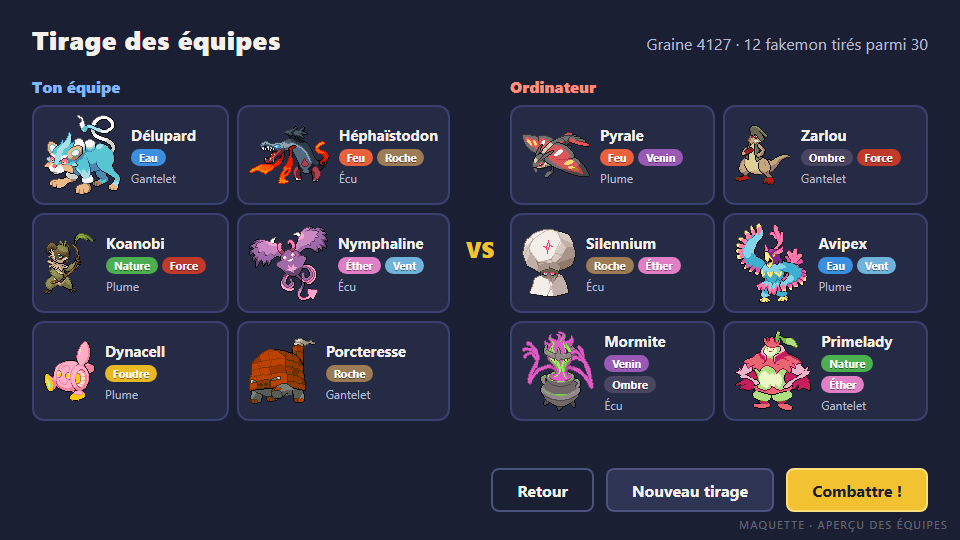
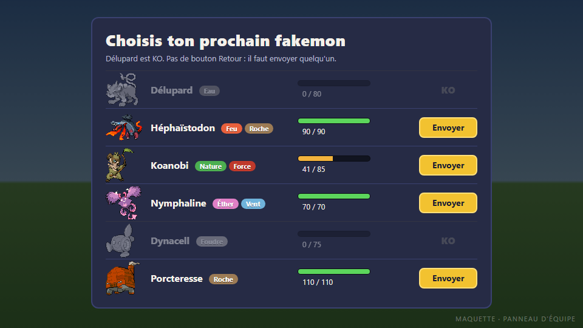
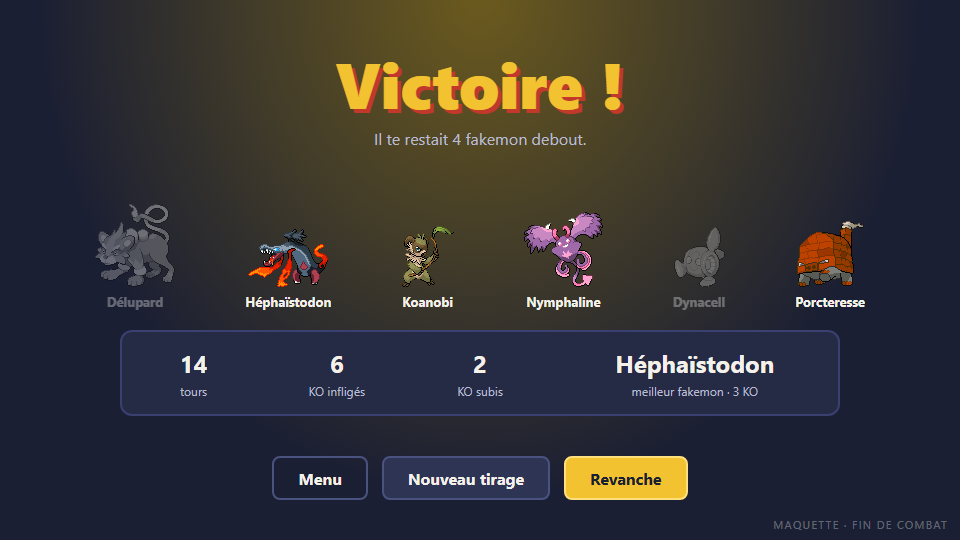
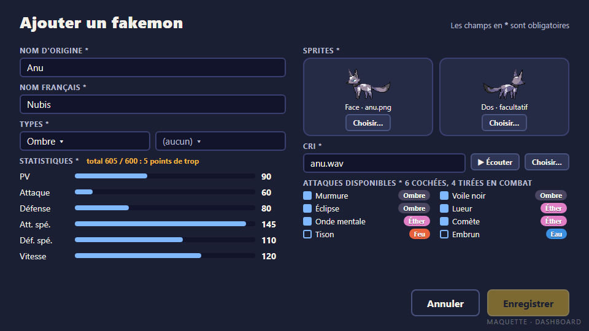

# GDD · Vision, écrans, direction artistique et son

> Issue #2 · Dev B · à valider par Dev A à la review du mercredi 4 novembre.

Les règles du combat (types, dégâts, talents, objets, roster) sont dans [gdd-regles.md](gdd-regles.md).

## 1. Vision

**Fakemon Arena** est un jeu de combat au tour par tour : deux équipes de six fakemon, tirées au hasard parmi trente, s'affrontent jusqu'au dernier. Le joueur affronte l'ordinateur sur PC ou Mac, à la souris.

- **Une partie dure environ 10 minutes.** Pas de progression à gérer : on lance, on se bat, on recommence.
- **Public visé :** les joueurs qui connaissent les jeux de combat de créatures et veulent une partie rapide, ainsi que le jury de la soutenance, qui doit tout comprendre en une démo de 5 minutes.

### Les quatre piliers

1. **Chaque tour compte.** Les types, la priorité et le changement de fakemon donnent un vrai choix à chaque tour, jamais un clic automatique.
2. **Jamais la même partie.** Le tirage des équipes change tout : il faut s'adapter à l'équipe qu'on reçoit.
3. **Tout se lit d'un coup d'œil.** Couleurs des types, barres de PV et journal de combat : le joueur comprend toujours ce qui vient de se passer.
4. **Le roster grandit.** Le dashboard permet d'ajouter ses propres fakemon sans toucher au code.

## 2. Boucle de jeu

```
Menu ──▶ Tirage ──▶ Aperçu des équipes ──▶ Combat ──▶ Fin de combat
            ▲              │                 ▲  │          │
            └─ Nouveau ────┘                 │  ▼          ├─▶ Revanche (mêmes équipes)
               tirage                 Panneau d'équipe     ├─▶ Nouveau tirage
                                       (changement, KO)    └─▶ Menu
Menu ──▶ Dashboard ──▶ Menu
```

1. **Menu :** le joueur lance un combat, ajoute un fakemon ou règle le volume.
2. **Tirage :** le jeu tire deux équipes de 6, chacun avec 4 attaques et un objet.
3. **Aperçu :** le joueur découvre les deux équipes. Il peut relancer le tirage autant qu'il veut, puis lance le combat.
4. **Combat :** à chaque tour, il choisit une attaque ou un changement ; le tour se résout et s'affiche dans le journal.
5. **Fin :** victoire ou défaite, quelques chiffres, puis revanche, nouveau tirage ou retour au menu.

La navigation détaillée entre les écrans est modélisée dans `docs/uml/navigation.puml` (#5).

## 3. Les écrans

Toutes les maquettes sont à la taille de la fenêtre du jeu, **960 × 540**, avec les vrais sprites.

### Menu principal


- **Nouveau combat** lance le tirage.
- **Ajouter un fakemon** ouvre le dashboard.
- **Options** ouvre une petite fenêtre avec deux curseurs de volume, musique et effets (pas de maquette).
- **Quitter** ferme le jeu.
- Quelques fakemon du roster décorent l'écran.

### Aperçu des équipes



- Les deux équipes côte à côte, 6 contre 6 : sprite, nom, types et objet de chaque fakemon.
- **Nouveau tirage** relance le tirage ; **Combattre !** lance le combat ; **Retour** revient au menu.
- La graine du tirage est affichée : elle permet de rejouer exactement le même combat.

### Combat


- **En haut à droite**, le fakemon adverse, vu de face ; **en bas à gauche**, celui du joueur, vu de dos et un peu plus grand.
- Chaque fakemon a un encart : nom, types, objet, barre de PV et PV restants. La barre passe du **vert** à l'**orange** sous 50 %, puis au **rouge** sous 20 %.
- **Les 4 attaques** sont des boutons à la couleur de leur type, avec la catégorie (physique ou spéciale), la puissance, la précision et la mention « rapide » pour la priorité +1.
- **Le journal** affiche le tour en cours : qui attaque, l'efficacité, les dégâts.
- **Les pastilles** résument l'équipe : jaune pour le fakemon en jeu, vert pour les fakemon debout, gris pour les KO.
- **Équipe** ouvre le panneau d'équipe pour changer de fakemon, ce qui consomme le tour.
- Pendant la résolution du tour, les boutons sont désactivés et les animations s'enchaînent (#27).

### Panneau d'équipe



- La liste des 6 fakemon, avec leurs PV ; les fakemon KO sont grisés et ne peuvent pas être envoyés.
- **Changement volontaire :** un bouton Retour permet d'annuler et de revenir au choix d'attaque.
- **Après un KO** (maquette ci-dessus) : pas de bouton Retour, il faut envoyer un fakemon.

### Fin de combat



- **Victoire !** ou **Défaite**, avec l'équipe du joueur : les fakemon KO sont grisés.
- Quelques chiffres : nombre de tours, KO infligés et subis, meilleur fakemon.
- **Revanche** relance un combat avec les mêmes équipes ; **Nouveau tirage** repasse par l'aperçu ; **Menu** revient au menu.

### Dashboard : ajouter un fakemon



- **Nom d'origine** et **nom français** : obligatoires, et uniques dans le roster.
- **Types :** un ou deux, choisis parmi les 10.
- **Statistiques :** 6 curseurs entre 50 et 150, avec le total affiché en direct ; il ne doit pas dépasser 600.
- **Sprites :** la face est obligatoire. Le dos est facultatif : sans dos, le jeu affiche la face retournée.
- **Cri :** un fichier `.wav`, qu'on peut écouter avant d'enregistrer.
- **Attaques disponibles :** au moins 4 attaques cochées dans la liste des 30.
- **Enregistrer** reste grisé tant qu'une règle n'est pas respectée, et le message dit laquelle (en orange sur la maquette : 5 points de stats en trop).
- Le fakemon est enregistré dans le dossier utilisateur et rejoint le tirage dès le combat suivant (#22).

## 4. Direction artistique

### Sprites

- **Source :** les 30 fakemon viennent de la collection libre [Mongratis](https://pokengine.org/collections/107s7x9x/Mongratis), utilisable gratuitement avec crédit. Le fichier `CREDITS.md`, livré avec les sprites, nomme le designer de chaque créature ; le README y renvoie.
- **Face et dos fournis** pour les 30, en pixel art, de 33 à 101 pixels de large selon la créature.
- **Affichage :** face ×2 pour l'adversaire, dos ×2,5 pour le joueur, **sans lissage** (`ImageView.setSmooth(false)`) pour garder les pixels nets. Les sprites sont posés en bas, sur une plateforme ovale.
- **Fakemon du dashboard sans dos :** le jeu affiche la face retournée horizontalement.


### Palette

| Rôle | Couleur |
|---|---|
| Fond | `#1B1F33` (bleu nuit) |
| Panneaux | `#262B45`, bordure `#3A4170` |
| Accent, bouton principal | `#F2C230` (or) |
| Texte | `#F4F1EA`, secondaire `#B9BCD0` |
| PV | vert `#5CD65C`, orange `#F2B33D`, rouge `#E5533D` |

Chaque type a sa couleur, utilisée sur les étiquettes, les boutons d'attaque et les effets :

| Feu | Eau | Nature | Foudre | Roche | Vent | Venin | Force | Ombre | Éther |
|---|---|---|---|---|---|---|---|---|---|
| `#E8603C` | `#3B8FE0` | `#4CAF50` | `#E9B824` | `#9C7B55` | `#6FB3DB` | `#9B59B6` | `#C0392B` | `#4A4560` | `#E07FC6` |

### Typographie

- **Titres :** une police très grasse, sous licence libre (OFL), livrée dans `resources/css` avec la feuille de style JavaFX.
- **Texte :** la police système, pour rester lisible à petite taille.

## 5. Son

| Son | Quand | Source |
|---|---|---|
| **Musique du menu** | menu, aperçu, dashboard | musique libre de droits (CC0 ou CC-BY), par exemple sur OpenGameArt |
| **Musique de combat** | pendant le combat | idem |
| **Jingles** | victoire, défaite | idem |
| **Effets** | clic, attaque, super efficace, critique, attaque ratée, KO, soin, entrée en jeu | générés avec [jsfxr](https://sfxr.me) |
| **Cris** | entrée en jeu, et en plus grave au KO | un cri par fakemon, généré avec jsfxr, moins d'une seconde |

- **Volume :** deux curseurs, musique et effets, dans les options, gardés d'une partie à l'autre.
- **Dans le code :** `MediaPlayer` pour les musiques, `AudioClip` pour les effets et les cris (#28).
- **Crédits :** chaque musique CC-BY est créditée dans le README, avec son auteur et sa licence.

## 6. Hors périmètre

Prévu seulement si du temps se libère (milestone Bonus) :

- **Combat en réseau local** contre un autre joueur, après le Go / No-Go du lundi 16 novembre (#34, #35) ;
- **Statuts** : brûlure, poison, paralysie (#32) ;
- **IA heuristique**, qui choisit l'attaque la plus forte (#33).
