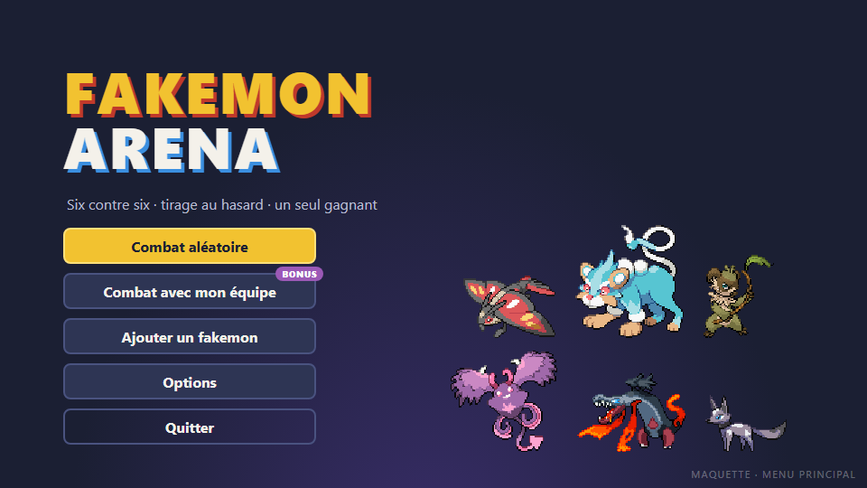
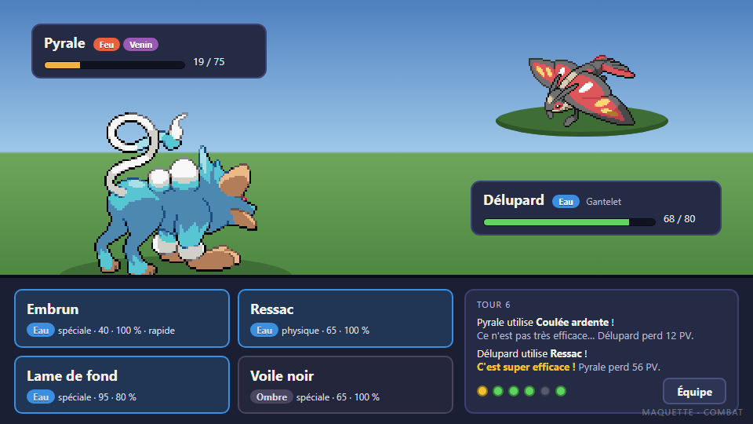
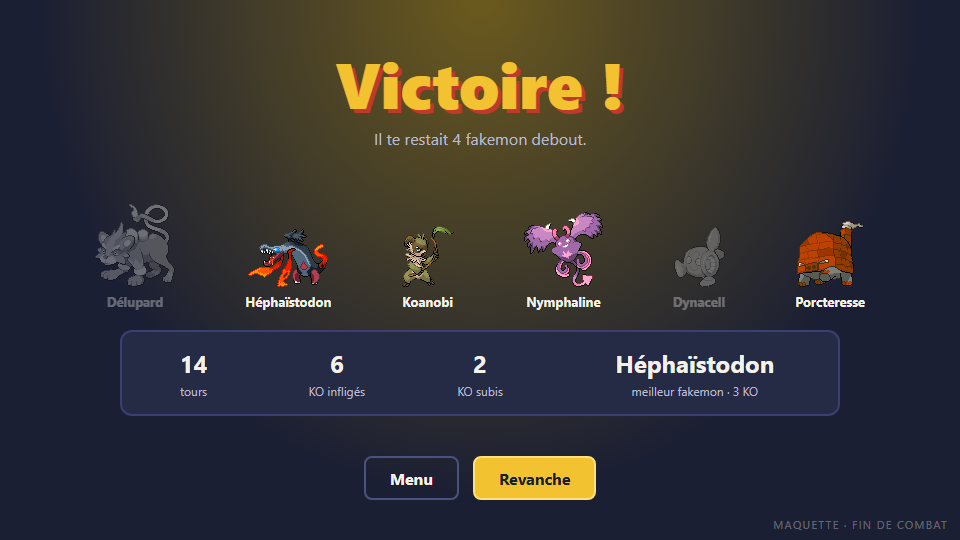
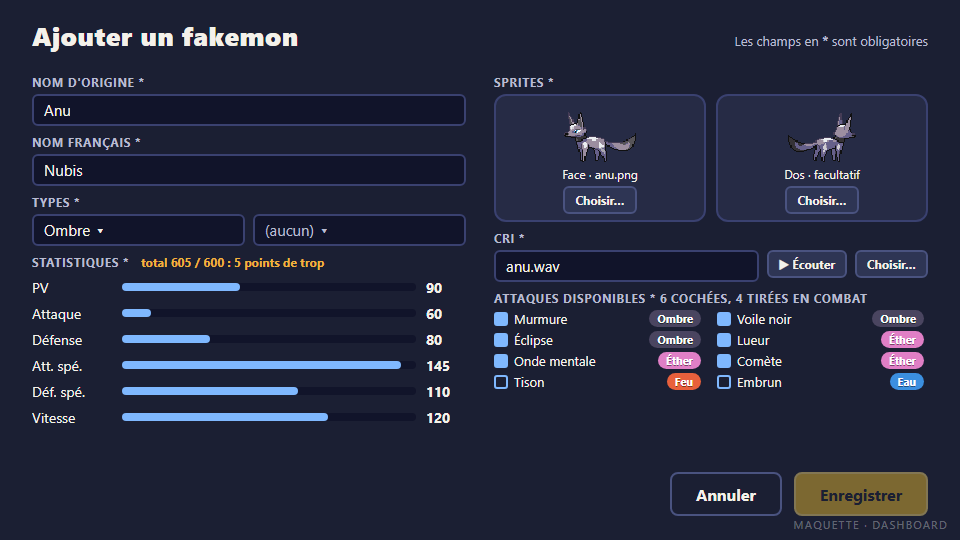
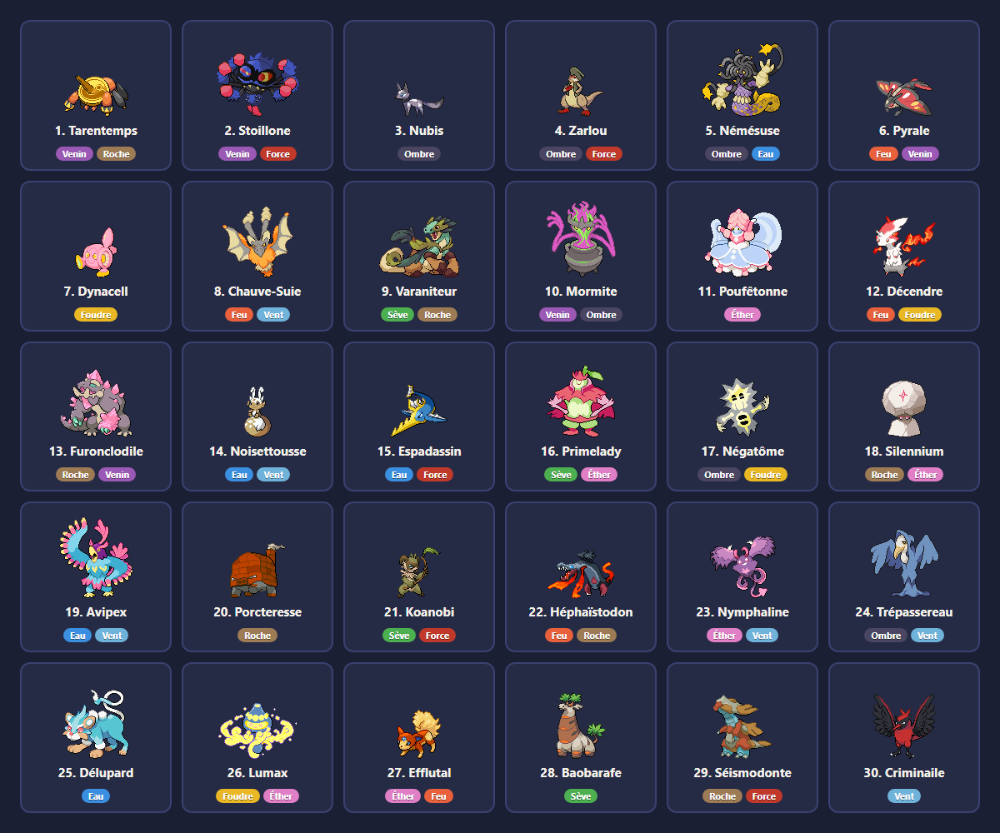

# GDD · Vision, écrans, direction artistique et son

> Issue #2 · Dev B · à valider par Dev A à la review du mercredi 4 novembre.

Les règles du combat (types, dégâts, talents, objets, roster) sont dans [gdd-regles.md](gdd-regles.md).

## 1. Vision

**Fakemon Arena** est un jeu de combat au tour par tour : deux équipes de six fakemon, tirées au hasard parmi trente, s'affrontent jusqu'au dernier. Le joueur affronte l'ordinateur ou, en bonus, un ami en ligne, sur PC ou Mac, à la souris.

- **Une partie dure environ 10 minutes.** Pas de progression à gérer : on lance, on se bat, on recommence.
- **Public visé :** les joueurs qui connaissent les jeux de combat de créatures et veulent une partie rapide, ainsi que le jury de la soutenance, qui doit tout comprendre en une démo de 5 minutes.

### Les quatre piliers

1. **Chaque tour compte.** Les types, la priorité et le changement de fakemon donnent un vrai choix à chaque tour, jamais un clic automatique.
2. **Jamais la même partie.** Le tirage des équipes change tout : on les découvre au début du combat, et il faut s'adapter à celle qu'on reçoit.
3. **Tout se lit d'un coup d'œil.** Couleurs des types, barres de PV et journal de combat : le joueur comprend toujours ce qui vient de se passer.
4. **Le roster grandit.** Ajouter un Mon permet de créer ses propres fakemon sans toucher au code ; ils apparaissent ensuite dans le Mondex et dans les combats.

## 2. Boucle de jeu

```
Menu ──▶ Combat contre l'IA ou en ligne ──▶ Combat ──▶ Fin de combat ──▶ Revanche ou Menu
  ├──▶ Mondex ──▶ Détails du Mon
  ├──▶ Ajouter un Mon
  ├──▶ Options
  └──▶ Crédits
```

1. **Menu :** le joueur lance un combat en ligne ou contre l'IA ; il peut aussi consulter le Mondex, ajouter un mon, régler le volume ou lire les crédits.
2. **Préparation :** en combat aléatoire, le jeu tire deux équipes de 6, chaque fakemon avec 4 attaques et un objet ; en combat construit (bonus), le joueur choisit ses 6 fakemon. Pas d'aperçu ni de nouveau tirage : les équipes se découvrent au début du combat.
3. **Combat :** à chaque tour, le joueur choisit une attaque ou un changement ; le tour se résout et s'affiche dans le journal.
4. **Fin :** victoire ou défaite, quelques chiffres, puis revanche ou retour au menu.

La navigation complète est modélisée dans `docs/uml/`, avec un diagramme par partie : menu principal, combat contre l'IA, combat en ligne, écran de combat, Mondex et Ajouter un Mon (#5).

## 3. Les écrans

Toutes les maquettes sont à la taille de la fenêtre du jeu, **960 × 540**, avec les vrais sprites. Les maquettes du menu principal et d'Ajouter un Mon sont à refaire, et les nouveaux écrans (menus de combat, lobby, Choisissez vos fakemon, Mondex, Crédits) n'en ont pas encore.

**Sur chaque écran, Échap ou un bouton Retour ramène à l'écran précédent.** Deux exceptions : en combat, Échap ouvre la pause ; dans Ajouter un Mon, une fiche commencée demande confirmation.

### Menu principal



- Les boutons, dans cet ordre : **Combat en ligne** (bonus), **Combat contre l'IA**, **Mondex**, **Ajouter un Mon**, **Options**, **Crédits**, **Quitter**.
- Quelques fakemon du roster décorent l'écran.

### Combat contre l'IA

- Un menu avec trois boutons : **Combat construit** (bonus), **Combat aléatoire** et **Retour au menu principal**.
- **Combat aléatoire :** tout est tiré au hasard, les deux équipes, leurs attaques, leurs objets et le premier fakemon envoyé. Le combat commence directement.
- **Combat construit** (bonus) ouvre « Choisissez vos fakemon ».

### Choisissez vos fakemon (bonus)

- Les fakemon s'affichent en cartes, avec leur sprite. Un clic ajoute un fakemon à l'équipe, un deuxième clic le retire.
- **Valider** ne s'active qu'avec 6 fakemon. Leurs attaques et leur objet sont tirés au hasard ; l'ordinateur reçoit une équipe aléatoire.
- On ne peut pas ouvrir les Détails du Mon depuis cet écran.
- Au début du combat, le joueur choisit son premier fakemon dans le panneau d'équipe.

### Combat en ligne (bonus)

- Un menu avec trois boutons : **Héberger**, **Rejoindre** et **Retour au menu principal**. Le combat se joue sur le réseau local (#35).
- **Héberger** ouvre le lobby, avec deux places : l'hôte à gauche, avec son adresse IP affichée sous sa place, et l'invité à droite une fois connecté.
- **Rejoindre** affiche un champ pour taper l'adresse IP de l'hôte et un bouton **Rejoindre**. Une fois connecté, l'invité arrive dans le lobby, à droite. Si l'adresse est fausse ou que personne n'héberge, un message d'erreur s'affiche.
- **Dans le lobby**, l'invité clique sur **Prêt** ; l'hôte choisit **combat aléatoire** ou **combat construit**, puis lance la partie. En combat construit, les deux joueurs passent par « Choisissez vos fakemon », et le combat commence quand les deux ont validé.
- **Départs :** si l'invité quitte le lobby, sa place redevient vide. Si l'hôte le quitte, l'invité voit « L'hôte a quitté la partie » et revient au menu principal.
- **Connexion perdue** pendant le combat : le message s'affiche et le joueur revient au menu principal, sans vainqueur.

### Combat



- **Les équipes se découvrent ici.** Le premier fakemon envoyé est tiré au hasard en combat aléatoire, et choisi par le joueur dans le panneau d'équipe en combat construit. Le bouton **Équipe** montre les 6 fakemon du joueur.
- **En haut à droite**, le fakemon adverse, vu de face ; **en bas à gauche**, celui du joueur, vu de dos et un peu plus grand.
- Chaque fakemon a un encart : nom, types, objet, barre de PV et PV restants. La barre passe du **vert** à l'**orange** sous 50 %, puis au **rouge** sous 20 %.
- **Les 4 attaques** sont des boutons à la couleur de leur type, avec la catégorie (physique ou spéciale), la puissance, la précision et la mention « rapide » pour la priorité +1.
- **Le journal** affiche le tour en cours : qui attaque, l'efficacité, les dégâts.
- **Les pastilles** résument l'équipe : jaune pour le fakemon en jeu, vert pour les fakemon debout, gris pour les KO.
- **Équipe** ouvre le panneau d'équipe pour changer de fakemon, ce qui consomme le tour.
- Pendant la résolution du tour, les boutons sont désactivés et les animations s'enchaînent (#27).
- **Échap ouvre la pause**, pendant le choix de l'action : **Reprendre**, **Volume**, qui ouvre la même fenêtre que les Options, et **Abandonner**, qui compte comme une défaite et mène à l'écran de fin de combat.

### Panneau d'équipe


- La liste des 6 fakemon, avec leurs PV ; les fakemon KO sont grisés et ne peuvent pas être envoyés.
- **Changement volontaire :** un bouton Retour permet d'annuler et de revenir au choix d'attaque.
- **Après un KO** (maquette ci-dessus) : pas de bouton Retour, il faut envoyer un fakemon.
- **Début d'un combat construit :** le panneau sert à choisir le premier fakemon envoyé.

### Fin de combat



- **Victoire !** ou **Défaite**, avec l'équipe du joueur : les fakemon KO sont grisés.
- Quelques chiffres : nombre de tours, KO infligés et subis, meilleur fakemon.
- **Revanche** lance un nouveau combat dans le même mode : deux nouvelles équipes en combat aléatoire ; la même équipe du joueur, contre une nouvelle équipe de l'ordinateur, en combat construit. **Menu** revient au menu principal.
- **En ligne**, la revanche ne part que si les deux joueurs cliquent sur Revanche. Si l'un clique sur Menu, l'autre voit « L'adversaire a quitté la partie » et revient au menu principal.

### Mondex

- La liste des fakemon avec leur nom, dans l'ordre de leur numéro : les 30 du roster, puis ceux créés avec Ajouter un Mon.
- Un clic sur un fakemon ouvre **Détails du Mon** : noms français et d'origine, sprite de face, types, 6 stats, talent, cri avec un bouton pour l'écouter, concept et designer.

### Ajouter un Mon



- **Nom d'origine** et **nom français** : obligatoires, et uniques dans le roster.
- **Types :** un ou deux, choisis parmi les 10.
- **Statistiques :** 6 curseurs entre 50 et 150, avec le total affiché en direct ; il ne doit pas dépasser 600.
- **Talent :** obligatoire, choisi parmi les 4 talents des règles.
- **Sprites :** la face est obligatoire. Le dos est facultatif : sans dos, le jeu affiche la face retournée.
- **Cri :** un fichier `.wav`, qu'on peut écouter avant d'enregistrer.
- **Attaques disponibles :** au moins 4 attaques cochées dans la liste des 30.
- **Designer :** facultatif. Sans nom, Détails du Mon affiche « Créé par : Inconnu(e) ».
- **Enregistrer** reste grisé tant qu'une règle n'est pas respectée, et le message dit laquelle (en orange sur la maquette : 5 points de stats en trop). Après l'enregistrement, un message confirme l'ajout et la fiche est vidée, pour en créer un autre.
- Le fakemon est enregistré dans le dossier utilisateur ; il apparaît dans le Mondex et rejoint le tirage dès le combat suivant (#22).
- **Échap ou Retour :** si la fiche est vide, retour direct au menu principal ; si elle est commencée, « Quitter sans enregistrer ? », avec Oui et Non.

### Options

- Deux curseurs de volume, musique et effets, gardés d'une partie à l'autre. Rien d'autre pour l'instant.
- Le bouton Volume de la pause ouvre la même fenêtre.

### Crédits

- Les designers des créatures de la collection Mongratis.
- Les auteurs des musiques.
- Les deux développeurs et leurs rôles, l'école et le projet.
- Les outils utilisés : Java, JavaFX, jsfxr.
- Des remerciements, dont le texte reste à rédiger.

## 4. Direction artistique

### Sprites

- **Source :** les 30 fakemon viennent de la collection libre [Mongratis](https://pokengine.org/collections/107s7x9x/Mongratis), utilisable gratuitement avec crédit. Le fichier `CREDITS.md`, livré avec les sprites, nomme le designer de chaque créature ; le README et l'écran Crédits y renvoient.
- **Face et dos fournis** pour les 30, en pixel art, de 33 à 101 pixels de large selon la créature.
- **Affichage :** face ×2 pour l'adversaire, dos ×2,5 pour le joueur, **sans lissage** (`ImageView.setSmooth(false)`) pour garder les pixels nets. Les sprites sont posés en bas, sur une plateforme ovale.
- **Fakemon créés sans dos :** le jeu affiche la face retournée horizontalement.



### Palette

| Rôle | Couleur |
|---|---|
| Fond | `#1B1F33` (bleu nuit) |
| Panneaux | `#262B45`, bordure `#3A4170` |
| Accent, bouton principal | `#F2C230` (or) |
| Texte | `#F4F1EA`, secondaire `#B9BCD0` |
| PV | vert `#5CD65C`, orange `#F2B33D`, rouge `#E5533D` |

Chaque type a sa couleur, utilisée sur les étiquettes, les boutons d'attaque et les effets :

| Feu | Eau | Nature | Foudre | Roche | Vent | Venin | Force | Ombre | Éther |
|---|---|---|---|---|---|---|---|---|---|
| `#E8603C` | `#3B8FE0` | `#4CAF50` | `#E9B824` | `#9C7B55` | `#6FB3DB` | `#9B59B6` | `#C0392B` | `#4A4560` | `#E07FC6` |

### Typographie

- **Titres :** une police très grasse, sous licence libre (OFL), livrée dans `resources/css` avec la feuille de style JavaFX.
- **Texte :** la police système, pour rester lisible à petite taille.

## 5. Son

| Son | Quand | Source |
|---|---|---|
| **Musique du menu** | menus, Mondex, Ajouter un Mon, crédits | musique libre de droits (CC0 ou CC-BY), par exemple sur OpenGameArt |
| **Musique de combat** | pendant le combat | idem |
| **Jingles** | victoire, défaite | idem |
| **Effets** | clic, attaque, super efficace, critique, attaque ratée, KO, soin, entrée en jeu | générés avec [jsfxr](https://sfxr.me) |
| **Cris** | entrée en jeu, et en plus grave au KO | un cri par fakemon, généré avec jsfxr, moins d'une seconde |

- **Volume :** deux curseurs, musique et effets, dans les Options et dans la pause du combat, gardés d'une partie à l'autre.
- **Dans le code :** `MediaPlayer` pour les musiques, `AudioClip` pour les effets et les cris (#28).
- **Crédits :** chaque musique CC-BY est créditée dans le README et dans l'écran Crédits, avec son auteur et sa licence.

## 6. Hors périmètre

Prévu seulement si du temps se libère (milestone Bonus) :

- **Combat construit** : l'écran « Choisissez vos fakemon », dans le menu Combat contre l'IA ;
- **Combat en ligne** contre un ami sur le réseau local : menu, lobby et combat, après le Go / No-Go du lundi 16 novembre (#34, #35) ;
- **Statuts** : brûlure, poison, paralysie (#32) ;
- **IA heuristique**, qui choisit l'attaque la plus forte (#33).
