# Diagrammes UML

Les sources sont en PlantUML (`.puml`) ; les PNG sont générés à partir d'elles et commités à côté.

| Diagramme | Source | Issue |
|---|---|---|
| Architecture : vue d'ensemble | [architecture.puml](architecture.puml) | #6 |
| Architecture : réseau local (bonus) | [architecture-lan.puml](architecture-lan.puml) | #6 |
| Séquence d'un tour | [sequence-tour.puml](sequence-tour.puml) | #6 |
| Classes : modèle et effets | [classes-modele.puml](classes-modele.puml) | #6 |
| Classes : moteur, IA et données | [classes-moteur.puml](classes-moteur.puml) | #6 |
| Cas d'utilisation : vue d'ensemble | [cas-utilisation.puml](cas-utilisation.puml) | #5 |
| Cas d'utilisation : combat contre l'IA | [cu-combat-ia.puml](cu-combat-ia.puml) | #5 |
| Cas d'utilisation : combat en ligne (bonus) | [cu-combat-en-ligne.puml](cu-combat-en-ligne.puml) | #5 |
| Cas d'utilisation : Mondex | [cu-mondex.puml](cu-mondex.puml) | #5 |
| Cas d'utilisation : Ajouter un Mon | [cu-ajouter-un-mon.puml](cu-ajouter-un-mon.puml) | #5 |
| Navigation : menu principal | [navigation.puml](navigation.puml) | #5 |
| Navigation : combat contre l'IA | [combat-ia.puml](combat-ia.puml) | #5 |
| Navigation : combat en ligne (bonus) | [combat-en-ligne.puml](combat-en-ligne.puml) | #5 |
| Navigation : écran de combat | [combat.puml](combat.puml) | #5 |
| Navigation : Mondex | [mondex.puml](mondex.puml) | #5 |
| Navigation : Ajouter un Mon | [ajouter-un-mon.puml](ajouter-un-mon.puml) | #5 |

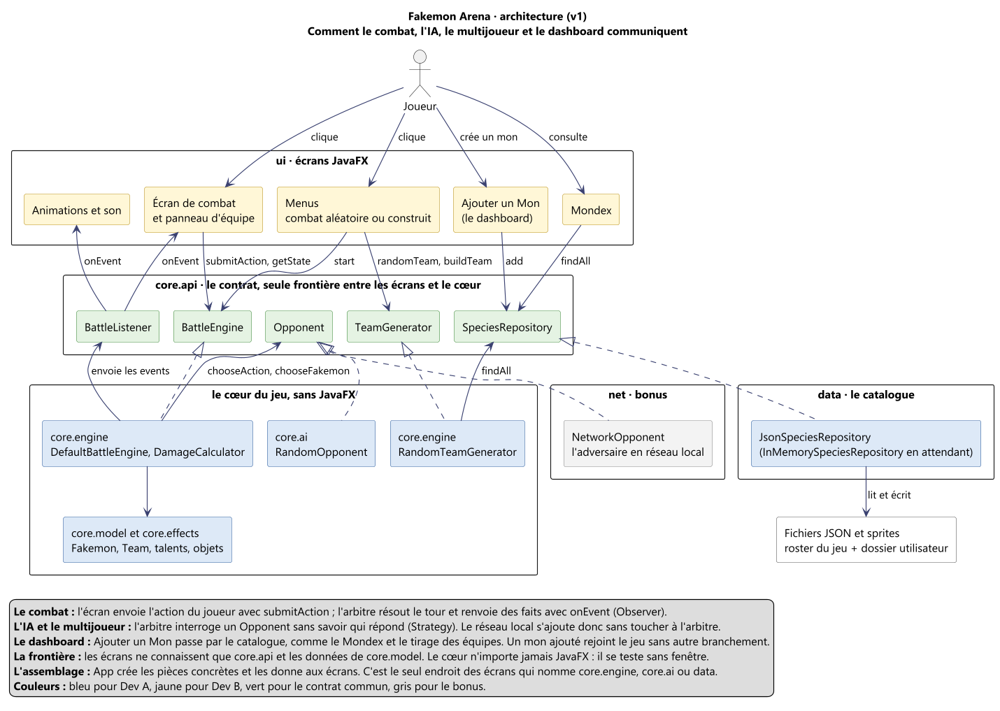

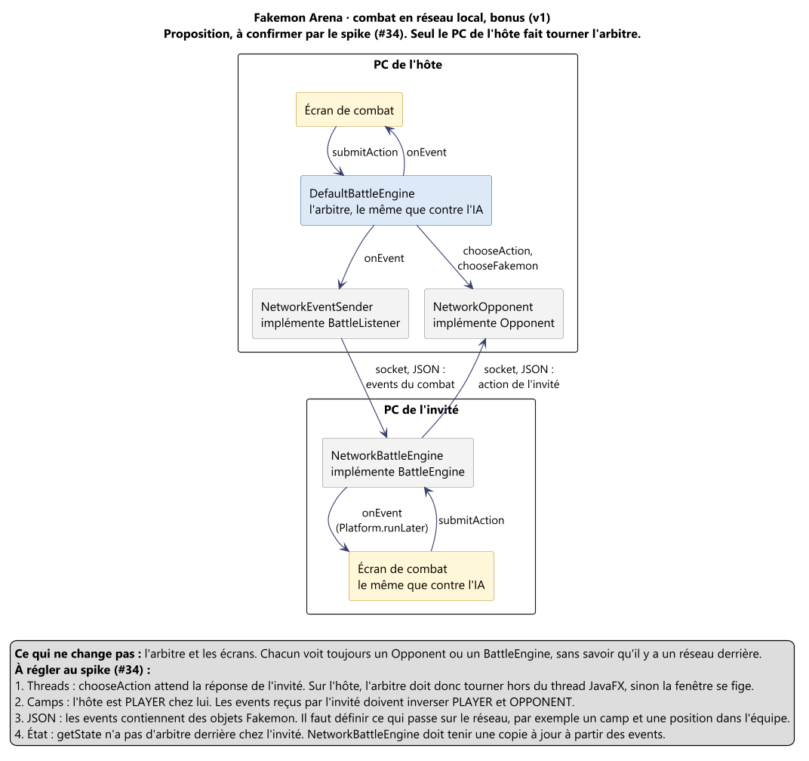

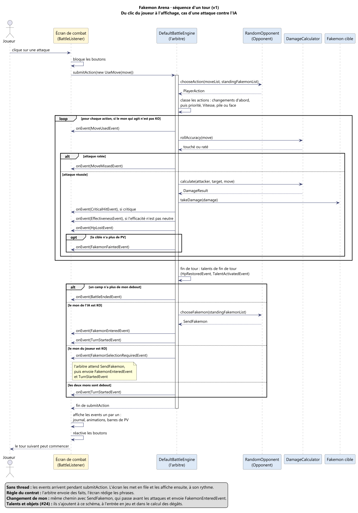

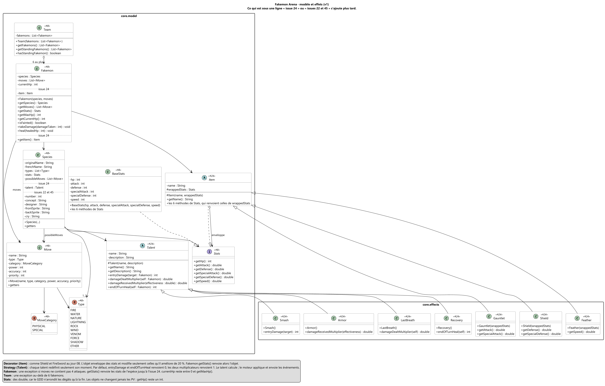

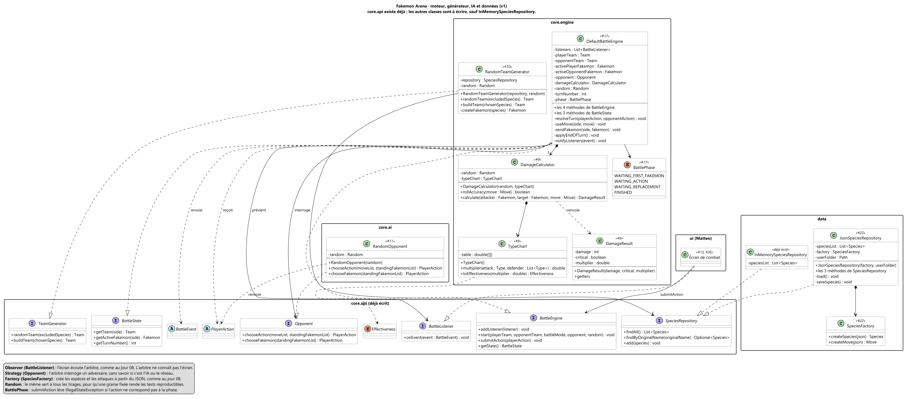

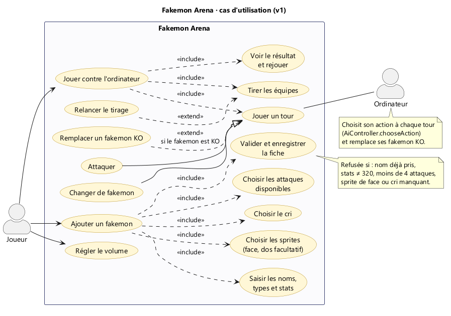

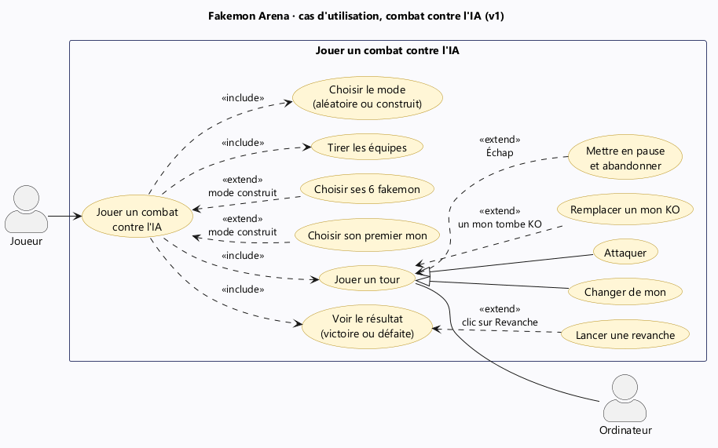

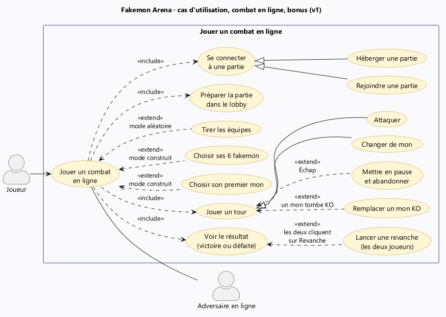

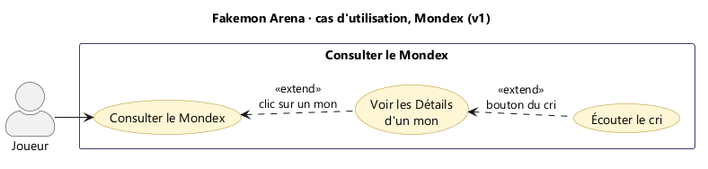

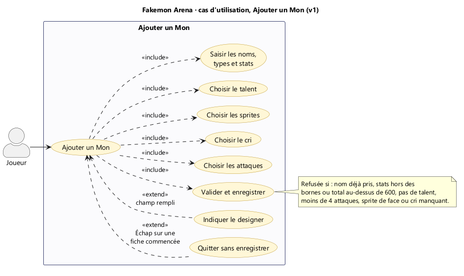

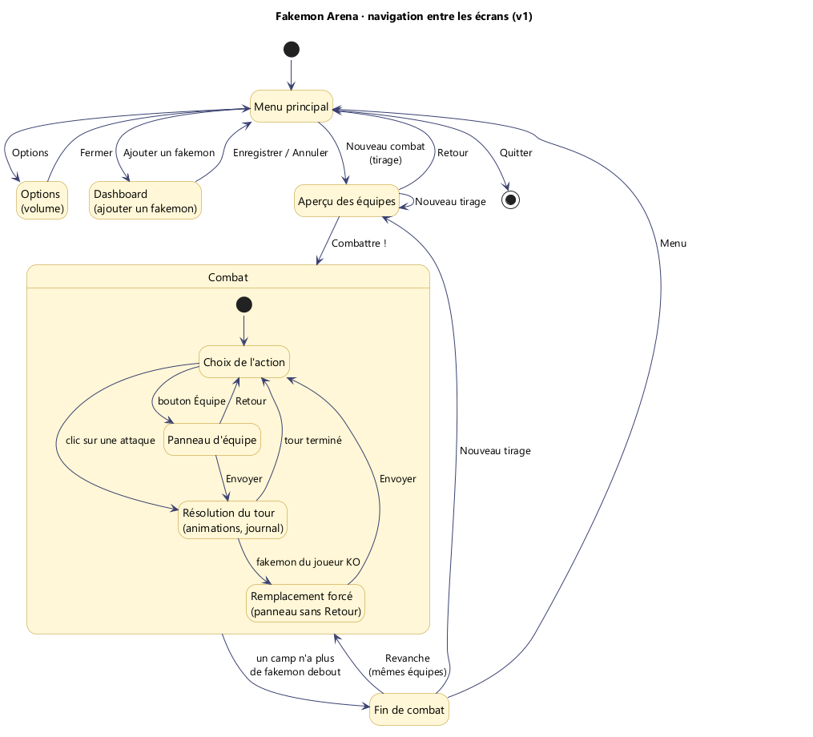

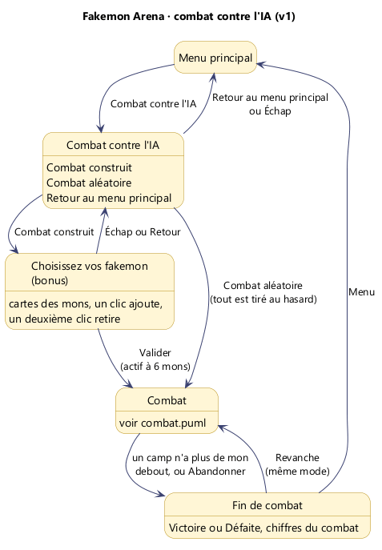

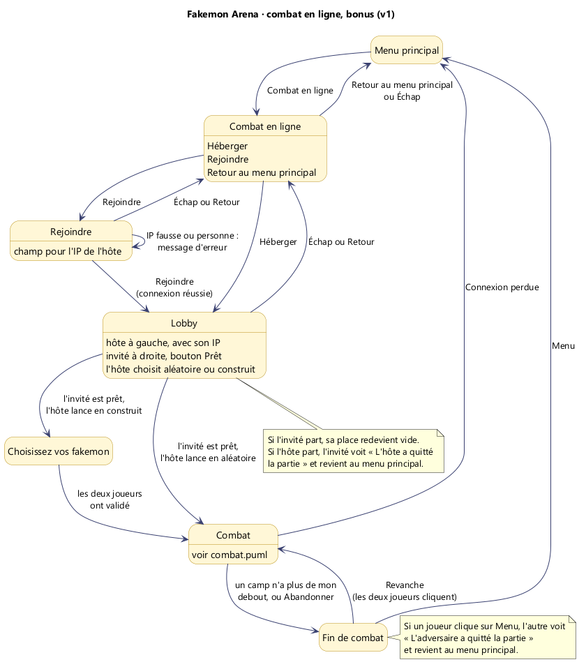

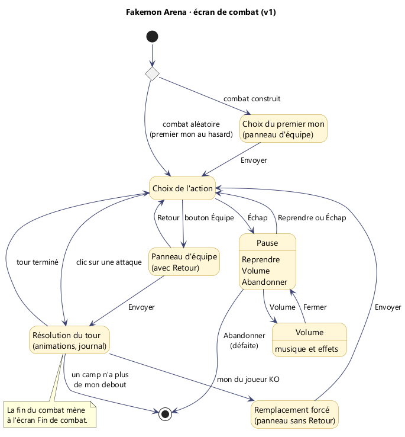

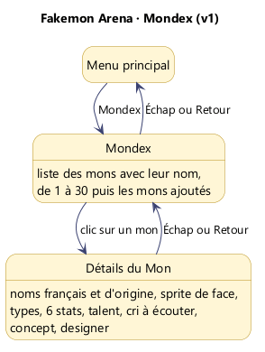

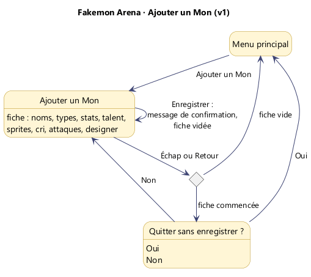

## Régénérer les PNG

Les diagrammes utilisent `!pragma layout smetana` : pas besoin d'installer Graphviz, Java suffit.

- **VS Code :** extension *PlantUML* (jebbs), clic droit dans le fichier → *Export Current Diagram* → PNG.
- **Terminal :** téléchargez `plantuml.jar` depuis [plantuml.com/download](https://plantuml.com/download), puis, depuis la racine du dépôt :

```bash
java -jar plantuml.jar -tpng -charset UTF-8 docs/uml/*.puml
```

Après chaque modification d'un `.puml`, régénérez le PNG et commitez les deux ensemble.
